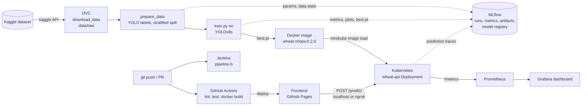

# wheat-mlops: Pipeline A

An end-to-end MLOps pipeline for **wheat head detection** on the Kaggle
[Global Wheat Detection](https://www.kaggle.com/competitions/global-wheat-detection) dataset,
using an Ultralytics YOLOv8 model. This branch is **Pipeline A** (DVC + MLflow + GitHub Actions).
The sister branch [`pipeline-b`](../../tree/pipeline-b) does the same with DVC-only experiment
tracking and Jenkins, so the two approaches can be compared.

| | Link |
|---|---|
| Repository | https://github.com/Saatvik-Sinha/wheat-mlops (branch `pipeline-a`) |
| Live frontend (GitHub Pages) | https://saatvik-sinha.github.io/wheat-mlops/ |
| CI/CD runs | [Actions tab](/.github/workflows/ci.yml) |

---

## Contents
1. [Problem statement and aim](#1-problem-statement-and-aim)
2. [The 8 MLOps tools and how they connect](#2-the-8-mlops-tools-and-how-they-connect)
3. [Repository layout](#3-repository-layout)
4. [Prerequisites](#4-prerequisites)
5. [Step-by-step reproduction](#5-step-by-step-reproduction)
6. [CI/CD with GitHub Actions](#6-cicd-with-github-actions)
7. [Results and metrics](#7-results-and-metrics)
8. [Troubleshooting](#8-troubleshooting)
9. [Clean up](#9-clean-up)
10. [Team](#10-team)

---

## 1. Problem statement and aim

**Problem.** Counting and locating wheat heads in field photos is used to estimate crop density,
health and yield. Doing it by hand is slow. The images are hard for a model: wheat heads overlap,
vary in size, colour and maturity, and photos come from different countries, growth stages and
lighting conditions.

**Data.** 3,422 training images (1024 x 1024 px, top-down field photos) with about 147k bounding
boxes in `train.csv` (`image_id, width, height, bbox=[x, y, w, h], source`).

**Aim.** The goal is not the leaderboard. It is to build a **reproducible, automated pipeline**
around a reasonable detector:
- Version the data, and track every data preparation and training run with its parameters, metrics and artifacts;
- Serve the trained model behind an API, packaged in a container and deployed on Kubernetes;
- Monitor the live service (traffic, latency, errors, detection quality);
- Test and deploy automatically on every change (CI/CD);
- Make the result usable through a simple web frontend.

---

## 2. The 8 MLOps tools and how they connect

| # | Tool | What it does in this project | Where |
|---|---|---|---|
| 1 | **DVC** | Versions the raw dataset (`download_data` stage) | `dvc.yaml`, `dvc.lock`, `.dvc/` |
| 2 | **MLflow** | Tracks data preparation, model build, training runs, model registry (`wheat-yolo`) and API prediction traces | `MLproject`, `pipeline.py`, `train.py`, `api.py` |
| 3 | **Docker** | Packages the API and trained model into an image | `docker/Dockerfile` |
| 4 | **Kubernetes** (minikube) | Runs the API as a Deployment and Service with health probes and resource limits | `k8s/` |
| 5 | **Prometheus** | Scrapes `/metrics` from the API, evaluates alert rules | `monitoring/1*-prometheus*.yaml` |
| 6 | **Grafana** | Dashboard for traffic, p50/p95 latency, error rate, detections and confidence | `monitoring/2*-grafana*.yaml`, `monitoring/dashboards/` |
| 7 | **GitHub Actions** | CI/CD on `pipeline-a`: lint, test, Docker build, deploy frontend to GitHub Pages | `.github/workflows/ci.yml` |
| 8 | **Jenkins** | The same CI on `pipeline-b` (lint, test, DVC check) | `Jenkinsfile`, `jenkins/` on branch `pipeline-b` |

Supporting tools: **uv** (Python environments), **pytest** and **ruff** (tests and lint),
**FastAPI** (API), **ngrok** (public URL for the local API), **Kaggle GPU notebooks** (training), **docker**, **minikube**, **kubectl**.



---

## 3. Repository layout

```
params.yaml                 single source of truth for paths and data/model parameters
train_params.yaml           training hyper-parameters (Fresh YOLOv8s, 50 epochs, augmentations)
improve_params.yaml         finetuning hyper-parameters (last checkpoint, 5 epochs, augmentations)
dvc.yaml, dvc.lock          DVC stage that downloads the raw data
MLproject                   MLflow project entry points (main, prepare_data, build_model)
src/python/wheat_mlops/     the Python package
  download_data.py            Kaggle download -> data/raw
  prepare_data.py             data/raw -> data/processed (YOLO format, stratified train/val split)
  build_model.py              pretrained YOLO -> checkpoints/base (smoke inference)
  pipeline.py                 MLflow pipeline runner (prepare + build in one tracked run)
  train.py                    training script, logs to MLflow and registers the model
  api.py                      FastAPI service: /predict, /health, /metrics
src/notebooks/kaggle_train.ipynb   training notebook for a Kaggle GPU session
docker/                     Dockerfile (builder / runtime / serve stages) and smoke test
k8s/                        Namespace, Deployment, Service, smoke-test Job
monitoring/                 Prometheus and Grafana manifests and dashboard JSON
frontend/index.html         static web UI (deployed to GitHub Pages)
.github/workflows/ci.yml    GitHub Actions CI/CD
tests/python/               test suite (needs no real data, model or GPU)
src/scripts/                launch scripts for local deployment
src/old_scripts/            helper scripts used during development and setup
init.sh / init.cmd          optional: create the virtualenv and open a dev shell
```

---

## 4. Prerequisites

| Tool | Version used | Needed for | Install |
|---|---|---|---|
| Git | 2.4x | everything | https://git-scm.com |
| **uv** | 0.11.x | Python env and all Python commands (installs Python 3.14 itself) | https://docs.astral.sh/uv/getting-started/installation |
| Kaggle account + API token | - | downloading the data (step 1) and training (step 3) | https://www.kaggle.com/settings -> *Create New Token* |
| Docker Desktop / Docker Engine | 27.x | steps 5-7 | https://docs.docker.com/get-docker |
| minikube | 1.3x | steps 6-7 | https://minikube.sigs.k8s.io/docs/start |
| kubectl | 1.3x | steps 6-7 (or use `minikube kubectl --`) | https://kubernetes.io/docs/tasks/tools |
| ngrok (optional) | 3.x | public URL for the API | https://ngrok.com/download |

Hardware: about 15 GB free disk and at least **8 GB RAM** (minikube is given 4 GB). No GPU is
needed locally.

All commands below are run from the **repository root**. They work in bash (Linux/macOS/Git Bash)
and in Windows PowerShell unless noted.

---

## 5. Step-by-step reproduction

### Step 0: Clone and install

```bash
git clone https://github.com/Saatvik-Sinha/wheat-mlops.git
cd wheat-mlops
git checkout pipeline-a
uv venv --python 3.14
source .venv/Scripts/activate
uv sync --all-groups
```

`uv sync` creates `.venv/` with Python 3.14 and every dependency from `uv.lock`
(DVC, MLflow, Ultralytics, pytest, ruff, ...). Prefix commands with `uv run` to use it.

> On Linux, `uv.lock` resolves the CUDA build of PyTorch (about 3 GB). Nothing here needs CUDA
> locally, so you can skip it by installing CPU wheels; the same approach is used in
> `docker/Dockerfile` and `.github/workflows/ci.yml`.

Check that everything works (no data needed):

```bash
uv run ruff check .
uv run ruff format --check .
uv run --with fastapi --with httpx --with prometheus-client --with python-multipart pytest
```

### Step 1: Get the data (Kaggle + DVC)

1. Open the [competition page](https://www.kaggle.com/competitions/global-wheat-detection) and
   click **Join Competition / I Understand and Accept** (the download is refused otherwise).
2. Put your Kaggle API token in place:
   - Linux/macOS: `~/.kaggle/kaggle.json` (`chmod 600 ~/.kaggle/kaggle.json`)
   - Windows: `C:\Users\<you>\.kaggle\kaggle.json`
3. Run the DVC stage:

```bash
uv run dvc repro
```

This downloads and unzips the data into `data/raw/` (`train.csv`, `train/*.jpg`, `test/*.jpg`). Running it again does nothing while the data is unchanged.

### Step 2: Prepare data and build the base model (MLflow pipeline)

```bash
uv run python -m wheat_mlops.pipeline
```

One MLflow run (experiment `wheat-mlops-pipeline-a`) that:
**prepare_data**: converts `train.csv` boxes to YOLO labels, drops boxes outside
   `min_box_area`/`max_box_area`, and makes a train/val split (80/20) stratified by source and
   by boxes per image. Output: `data/processed/` with `dataset.yaml`.

Parameters, data statistics and artifacts are logged to `mlflow.db`. The same entry points are
also declared as an MLflow Project in `MLproject`.

Open the MLflow UI:

```bash
uv run mlflow ui --backend-store-uri sqlite:///mlflow.db --port 5000
```

Open http://localhost:5000 to see the experiments `wheat-mlops-pipeline-a` (this step),
`wheat-train` (training) and `wheat-api` (prediction traces), plus the **Models** tab with
`wheat-yolo`.

### Step 3: Train the model (local)

Training does not need a GPU, so that model can easily run on local machine with low specs.

1. Start with the first round of training, which will download a pretrained instance of yolo and starts finetuning the model on our dataset.
`python -m wheat_mlops.train --data-yaml data/processed/dataset.yaml --out-dir data/working/trained --params ./train_params.yaml`

2. In order to continue training on the previuosly fintuned model, run the following command. 
`python -m wheat_mlops.train --data-yaml data/processed/dataset.yaml --out-dir data/working/trained --params ./improve_params.yaml`

3. All the training statistics and model artifacts will be saved in MLFlow database.

4. To view the results run the following commands to open the dashboards
`./src/old_scripts/start_mlflow_ui.sh`

### Step 4: Build and run the API with Docker

The image has three stages: `builder` (installs CPU-only dependencies), `runtime` (slim base,
runs `smoke_test.py`) and `serve` (runtime + API + `data/working/trained/best.pt`).

```bash
# smoke-test image (no model needed)
docker build -f docker/Dockerfile --target runtime -t wheat-mlops:runtime .
docker run --rm wheat-mlops:runtime          # prints SMOKE TEST PASSED

# serving image (needs data/working/trained/best.pt from step 3)
docker build -f docker/Dockerfile -t wheat-mlops:0.2.0 .
docker run --rm -p 8000:8000 wheat-mlops:0.2.0
```

Try it (in a second terminal):

```bash
curl http://localhost:8000/health
curl -F "file=@data/raw/test/2fd875eaa.jpg" "http://localhost:8000/predict?conf=0.25"
```

Interactive API docs are at http://localhost:8000/docs. Stop the container with `Ctrl+C`.

| Endpoint | Description |
|---|---|
| `GET /health` | `{"status": "ok", "model_loaded": true, ...}` (503 while the model loads) |
| `POST /predict?conf=0.25&iou=0.7` | multipart `file` (JPEG/PNG, max 10 MB) -> `count`, `mean_confidence`, `detections` (boxes + scores), `inference_ms`, `model_version` |
| `GET /metrics` | Prometheus metrics |

### Step 5: Deploy on Kubernetes (minikube)

```bash
IMAGE='wheat-mlops:0.2.0'
NAMESPACE='wheat-mlops'
PUBLIC_HEALTH_URL='https://oxychloric-carma-subgelatinously.ngrok-free.dev/health'

minikube config set memory 4096
minikube start --driver=docker --cpus=6 --memory=4096
minikube kubectl -- apply -f k8s/00-namespace.yaml

docker build -f docker/Dockerfile --target serve -t "$IMAGE" .
minikube image load "$IMAGE"

minikube kubectl -- create secret generic wheat-api-secrets \
    -n "$NAMESPACE" --from-env-file=.env --dry-run=client -o yaml |
    minikube kubectl -- apply -f -
minikube kubectl -- apply -f k8s/
minikube kubectl -- rollout status deployment/wheat-api -n "$NAMESPACE" --timeout=300s
```

The pod is ready when `/health` passes; the startup probe allows up to 3 minutes for the model
to load. Open the API on your machine:

```bash
echo 'Starting local port forwards...'
minikube kubectl -- port-forward -n "$NAMESPACE" svc/wheat-api 8000:80
ngrok http 8000 --url=https://oxychloric-carma-subgelatinously.ngrok-free.dev
```

`http://localhost:8080/health` should answer. Leave this terminal open.

Optional in-cluster smoke test:

```bash
minikube kubectl -- delete job wheat-smoke-test --ignore-not-found -n "$NAMESPACE"
minikube kubectl -- apply -f k8s/jobs/smoke-test.yaml 
minikube kubectl -- wait --for=condition=complete job/wheat-smoke-test --timeout=180s -n "$NAMESPACE"
minikube kubectl -- logs job/wheat-smoke-test -n "$NAMESPACE"
```

What the manifests set up: namespace `wheat-mlops`; Deployment `wheat-api` (1 replica, rolling
update, startup/readiness/liveness probes on `/health`, CPU/memory requests and limits, non-root
user); ClusterIP Service `wheat-api` (port 80 -> 8000). `imagePullPolicy: Never` because the image
is loaded into minikube instead of pulled from a registry.

### Step 6: Monitoring (Prometheus + Grafana)

```bash
minikube kubectl -- apply -f monitoring/
minikube kubectl -- rollout status deployment/prometheus -n "$NAMESPACE" --timeout=180s
minikube kubectl -- rollout status deployment/grafana -n "$NAMESPACE" --timeout=180s
```

In two more terminals:

```bash
minikube kubectl -- port-forward -n "$NAMESPACE" svc/prometheus 9090:9090
minikube kubectl -- port-forward -n "$NAMESPACE" svc/grafana 3000:3000
```

- **Prometheus**: http://localhost:9090/targets shows `prometheus` and `wheat-api` as **UP**.
  Alerts (`WheatApiHighP95Latency`, `WheatApiHighErrorRate`, `WheatApiDown`) are at
  http://localhost:9090/alerts.
- **Grafana**: http://localhost:3000 (anonymous access is on; login is `admin` / `admin`).
  Open **Dashboards -> Wheat Detection -> Wheat Detection API - Performance & Quality**.
  The panels fill up once you send a few predictions (step 7).

Example queries for the Prometheus *Graph* page:

```
up{job="wheat-api"}
wheat_api_requests_total{endpoint="/predict"}
histogram_quantile(0.95, sum by (le) (rate(wheat_api_request_duration_seconds_bucket{endpoint="/predict"}[5m])))
```

Metrics exposed by the API: `wheat_api_requests_total`, `wheat_api_errors_total`,
`wheat_api_request_duration_seconds` (histogram), `wheat_api_detections_per_image`,
`wheat_api_detection_confidence`, plus the standard `process_*` metrics.
See `monitoring/README.md` for labels and buckets.

### Step 7: Use the frontend

Open https://saatvik-sinha.github.io/wheat-mlops/ (or open `frontend/index.html` locally).
A page will ask for a backend url, in the text field paste the following url - `https://oxychloric-carma-subgelatinously.ngrok-free.dev`

Upload a wheat image (for example from `data/raw/test/`), set the confidence threshold and click
**Detect**. The boxes are drawn on the image with the count and mean confidence. Every request
also shows up in Grafana and as a trace in MLflow.

---

## 6. CI/CD with GitHub Actions

Workflow: `.github/workflows/ci.yml`, triggered on every push and pull request to `pipeline-a`
(and manually from the Actions tab).

| Job | What it does | Runs on |
|---|---|---|
| **Lint (ruff)** | `ruff check` and `ruff format --check` on all Python code (`src/notebooks/` is excluded in `pyproject.toml`) | push, PR |
| **Test (pytest)** | installs dependencies with CPU-only PyTorch, runs the full test suite | push, PR |
| **Docker image builds** | builds the `runtime` stage of `docker/Dockerfile` (no push), with layer caching | push, PR, after lint and test |
| **Deploy frontend to GitHub Pages** | publishes `frontend/` to https://saatvik-sinha.github.io/wheat-mlops/ | push to `pipeline-a` only, after lint and test |

`pipeline-a` is a protected branch: changes come in through pull requests that need one
approving review, and the checks above run on every PR. To run the same checks locally, see
step 0.

The Jenkins version of this CI is on the `pipeline-b` branch (`Jenkinsfile`, setup in
`jenkins/README.md`).

---

## 7. Results and metrics

**Detection metrics** (validation split, 20% of the training images):

| Metric | Value |
|---|---|
| Precision | 0.9005859501439452 |
| Recall | 0.8510807504893526 |
| mAP@0.5 | 0.9187512537340577 |
| mAP@0.5:0.95 | 0.49727182434616496 |

- **Precision / Recall**: share of predicted boxes that are correct / share of true wheat heads found.
- **mAP@0.5**: mean average precision with a box counted as correct at IoU >= 0.5.
- **mAP@0.5:0.95**: average of mAP over IoU thresholds 0.5 to 0.95. This is the stricter COCO
  metric and the closest to the competition metric.

Training curves (loss, precision, recall, mAP per epoch), the PR curve and the confusion matrix
are in `data/working/trained/run/` after step 3, and in the MLflow run under **Artifacts -> plots**.

**Service metrics** (from Prometheus/Grafana): request rate, p50/p95 latency of `/predict`,
error rate, detections per image and mean confidence per image.

---

## 8. Clean up

```bash
minikube kubectl -- delete namespace wheat-mlops     # removes the API, Prometheus and Grafana
minikube stop                            # or: minikube delete
docker image rm wheat-mlops:0.2.0 wheat-mlops:runtime
```

---

## 9. Team

| Member | Tools |
|---|---|
| Anirudh Sharma | DVC, MLflow, Training |
| Saatvik Sinha | Docker, Kubernetes |
| Ritu Raj Sharma | GitHub Actions, Jenkins |
| Lomesh Soni | Prometheus, Grafana |
